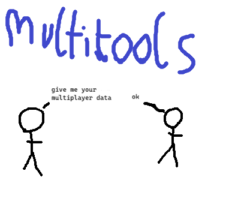

MultiTools is a custom [PenguinMod](https://penguinmod.com/) extension designed to help creating multiplayer projects
it uses a peer-to-peer (P2P) connection using WebRTC to handle all of the networking. It offers a wide range of tools for making multiplayer projects more accesible to people who dont want to go through the struggle of cloud variables and whatnot.

# Features
- P2P Multiplayer – Real-time peer-to-peer communication.

- Room System – Create and join multiplayer rooms using IDs.

- Player Management – Detect when players join or disconnect.

- Messaging – Send messages between connected players.

- Custom Events – Create and trigger custom multiplayer events.

- Live Events – Build interactive events that players can experience together.

And More!
